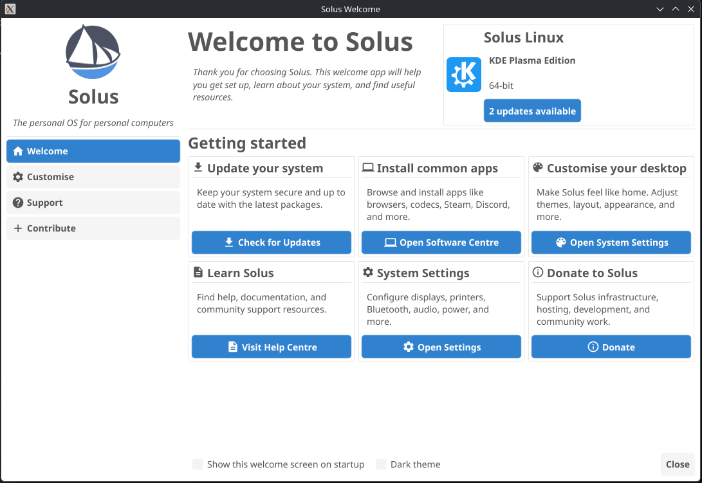

# Solus Welcome

[](https://github.com/Vyrnexis/welcome-app/actions/workflows/ci.yml)

Solus Welcome is a native desktop application that helps new and returning Solus users inspect their system, install updates, open desktop settings, discover software, and find official community resources.

The application is written in Go with the [Fyne](https://fyne.io/) GUI toolkit and supports the Budgie, GNOME, KDE Plasma, and Xfce editions of Solus.

<p align="center">
  
</p>

## Features

- Detects the active Budgie, GNOME, KDE Plasma, or Xfce desktop session.
- Displays the desktop edition, architecture, Linux kernel, and installed memory.
- Checks for available `eopkg` upgrades without blocking the interface.
- Opens the appropriate software centre, appearance tools, and system settings for the active desktop.
- Provides direct links to Solus documentation, support channels, contribution guides, and donations.
- Shown on first login via system autostart, with the option for users to opt out.
- Theme follows system settings with manual Light and Dark mode overrides.
- Embeds all runtime assets, icons, and translations directly into the binary.
- Regional and base-language translation fallbacks using Fyne i18n.
- Installs from a release binary archive or compiles from source.

## Keyboard shortcuts

| Shortcut | Action |
| --- | --- |
| `F1` | Open Welcome |
| `F2` | Open Customise |
| `F3` | Open Support |
| `F4` | Open Contribute |
| `Ctrl+Q` | Quit the application |

## Installation

### Install a published release

Download the Linux x86-64 archive from the [Releases page](https://github.com/Vyrnexis/welcome-app/releases). This archive contains the precompiled binary, desktop entries, app icon, and installer script.

The optional `checksums.txt` release asset can verify the archive before extraction when both files are in the same directory:

```bash
sha256sum --check checksums.txt
```

Extract the archive, enter the extracted directory, and run the installer:

```bash
tar -xzf solus-welcome-v0.2.0-linux-x86_64.tar.gz
cd solus-welcome-v0.2.0
./install.sh
```

In release archives without source files, `./install.sh` automatically uses the prebuilt binary (`--prebuilt`).

### Install from a repository checkout

Release binaries are not committed to git. To install from a git clone, compile and install from source:

```bash
git clone https://github.com/Vyrnexis/welcome-app.git
cd welcome-app
./install.sh
```

In checkouts containing source files, `./install.sh` defaults to compiling from source (`--build`). You can also specify `--build` or `--prebuilt` explicitly.

### Custom prefix and unprivileged installation

By default, the installer targets `/usr` and requests `sudo` only when required to write to target directories.

To install into a user directory without `sudo`, provide a custom `PREFIX`:

```bash
PREFIX="$HOME/.local" ./install.sh
```

An alternate absolute prefix such as `/opt` is also supported:

```bash
PREFIX=/opt/solus-welcome ./install.sh
```

Packagers can stage an installation without `sudo` by setting `DESTDIR`:

```bash
DESTDIR=/tmp/solus-welcome-package PREFIX=/usr ./install.sh --prebuilt
```

When `PREFIX` is not `/usr`, desktop entry `Exec` paths are automatically rewritten to the absolute binary path (`$PREFIX/bin/solus-welcome`).

### Uninstalling

To uninstall Solus Welcome and remove installed desktop entries, icons, and autostart files:

```bash
./install.sh --uninstall
```

If Solus Welcome was installed with a custom `PREFIX` or `DESTDIR`, pass the same variables when uninstalling:

```bash
PREFIX="$HOME/.local" ./install.sh --uninstall
```

### Distribution packaging

A draft packaging recipe for Solus (`ypkg` / `solbuild`) is provided in [`packaging/package.yml`](packaging/package.yml). See [`packaging/README.md`](packaging/README.md) for packager instructions.

### Installation paths

The default installation uses `/usr` and installs the following files:

- `/usr/bin/solus-welcome`
- `/usr/share/applications/us.getsol.SolusWelcome.desktop`
- `/usr/share/icons/hicolor/scalable/apps/us.getsol.SolusWelcome.svg`
- `/etc/xdg/autostart/us.getsol.SolusWelcome.desktop`

The installer requests `sudo` only when writing to directories that require elevated permissions (evaluated per target file).

## Build requirements

Building from source requires:

- Go at the version declared in `go.mod`.
- A C compiler and development tools.
- OpenGL, X11, Wayland, and XKB development headers required by Fyne.

On Solus, install the development dependencies with:

```bash
sudo eopkg install -c system.devel golang mesalib-devel libxrandr-devel libxcursor-devel libxi-devel libxinerama-devel wayland-devel libxkbcommon-devel libxxf86vm-devel
```

## Development

Run the application directly from the repository root:

```bash
go run ./src
```

Format, analyze, and test the project:

```bash
gofmt -s -w .
go vet ./...
go test -v -race ./...
./test/install_test.sh
```

Build the stripped binary:

```bash
mkdir -p bin
go build -trimpath -ldflags="-s -w" -o bin/solus-welcome ./src
```

## Translations

Translations live in `assets/translations/` as JSON files using [Fyne's i18n](https://fyne.io/) system. All translations are embedded directly into the binary at build time. See the [translation guide](assets/translations/README.md) for details on contributing translations.

## Project layout

| Path | Purpose |
| --- | --- |
| `src/` | Application source and Go tests |
| `assets/` | Artwork, application logo, and translations |
| `data/` | Desktop application and autostart entries |
| `packaging/` | Solus package recipe and packaging documentation |
| `test/install_test.sh` | Staged installer and uninstaller tests |
| `install.sh` | CLI installer and uninstaller |
| `.github/workflows/ci.yml` | Formatting, analysis, tests, build, packaging, and releases |

## CI and releases

Every push to `main` and every pull request targeting `main` runs formatting validation, module tidiness check, shell linting, desktop file validation, `go vet`, race-enabled Go tests, application build, and staged installer tests.

Tags beginning with `v` run a separate release job with repository write permission. That job packages the tested build artifact, desktop entries, app icon, installer script, and documentation into a release archive under a versioned top-level directory, verifies archive paths, generates a SHA-256 checksum, and publishes the GitHub release.

## Contributing

Read [CONTRIBUTING.md](CONTRIBUTING.md) before submitting code. Translation contributions should follow [assets/translations/README.md](assets/translations/README.md).

Use Conventional Commits for commit messages, keep functions documented, and do not commit changes that fail formatting, analysis, race tests, or installer tests.
